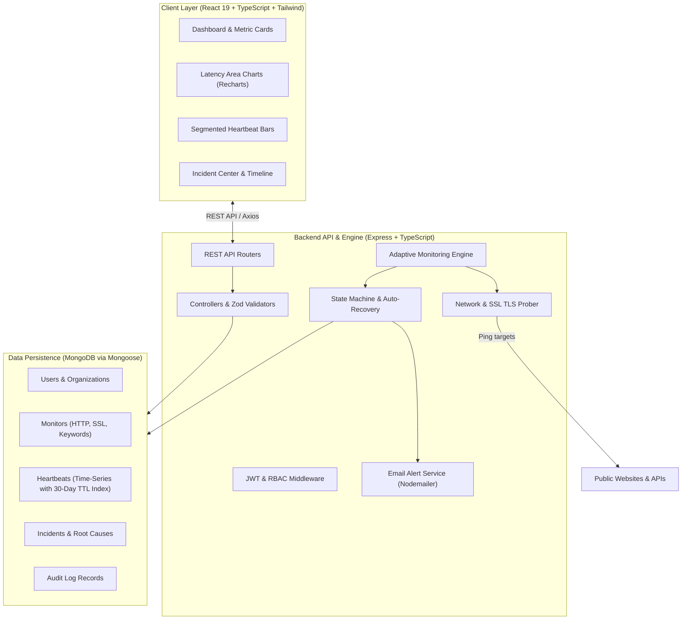

# ⚡ PulseWatch — Website & API Monitoring SaaS Platform

A production-grade, distributed website and API uptime monitoring platform modeled after **Better Stack** and **UptimeRobot**. Built with **Node.js, Express, TypeScript, MongoDB (Mongoose), React 19, Tailwind CSS, and Recharts**.

---

## 🌟 Key Features

- **24/7 High-Precision Synthetic Monitoring**:
  - Measures total latency ($t_{\text{latency}}$) with millisecond precision.
  - HTTP status verification & response body keyword assertions.
  - **SSL/TLS Certificate Inspector**: Probes peer TLS certificates on port 443 and calculates days remaining until expiration to alert users before certificate expiry.
- **Incident State Machine & Flapping Suppression**:
  - Distinguishes transient network blips from genuine downtime using consecutive failure thresholds.
  - Automatically creates incident records with root-cause diagnostics on downtime.
  - Automatically resolves active incidents when target endpoints recover, calculating exact downtime duration.
- **Email Alert Dispatcher**:
  - Automated HTML email alerts dispatched upon downtime and recovery via Nodemailer (with zero-config sandbox preview support).
- **Interactive Modern SaaS Dashboard**:
  - Real-time system health cards (24h Uptime %, Active Incidents, Total Targets, Global Latency).
  - **Segmented Heartbeat Bars** (Better Stack style) with hover tooltips displaying HTTP status code, latency, and timestamp.
  - **Interactive Latency Area Charts** with gradient fills (Recharts) for historical response times.
  - Manual **"Check Now"** instant trigger button for real-time probing.
- **Enterprise Team Management & RBAC**:
  - Organization workspaces with Role-Based Access Control (`Owner`, `Admin`, `Member`, `Viewer`).
  - Invite team members with role assignments and temporary credentials.
- **Security & Audit Logs**:
  - Immutable audit trail recording user operations, monitor configurations, and authentication actions with IP tracking.
- **Authentication**:
  - JWT Access Tokens (short-lived) + Refresh Token rotation with cryptographic hashing.

---

## 🏗️ System Architecture



---

## 📂 Project Structure

```
PulseWatch/
├── backend/
│   ├── src/
│   │   ├── config/          # Environment & Database config
│   │   ├── controllers/     # REST Controllers with Zod validation
│   │   ├── engine/          # Probe engine, State Machine, and Scheduler
│   │   ├── middleware/      # JWT auth, RBAC, Zod validator, Error handler
│   │   ├── models/          # Mongoose Schemas (User, Org, Monitor, Heartbeat, Incident, AuditLog)
│   │   ├── routes/          # Express route declarations
│   │   ├── scripts/         # Realistic demo database seeder
│   │   ├── services/        # Business logic & Nodemailer alert service
│   │   ├── app.ts           # Express application configuration
│   │   └── server.ts        # Server entry point & graceful shutdown
│   ├── tests/               # Vitest unit & integration test suite
│   ├── Dockerfile           # Multi-stage production Dockerfile
│   ├── package.json
│   └── tsconfig.json
├── frontend/
│   ├── src/
│   │   ├── components/      # Navbar, Sidebar, MonitorCard, SegmentedHeartbeatBar, Modal
│   │   ├── context/         # AuthContext with token refresh
│   │   ├── pages/           # Dashboard, MonitorDetail, Incidents, Team, Audit, Login, Register
│   │   ├── services/        # Axios API client with refresh interceptor
│   │   ├── types/           # TypeScript interfaces & types
│   │   ├── App.tsx          # React Router DOM configuration
│   │   └── index.css        # Tailwind CSS & sleek dark palette
│   ├── Dockerfile           # Multi-stage Dockerfile
│   ├── nginx.conf           # Production Nginx reverse-proxy
│   ├── package.json
│   └── vite.config.ts
├── docker-compose.yml       # Full stack container orchestration
└── README.md
```

---

## 🚀 Quick Start Guide

### 1. Prerequisites
- **Node.js**: v18+ (tested on Node v24)
- **MongoDB**: Local MongoDB or free [MongoDB Atlas](https://www.mongodb.com/cloud/atlas) cluster URL

### 2. Configure Backend Environment
In `backend/.env` (or copy from `backend/.env.example`):
```env
PORT=5000
NODE_ENV=development
MONGODB_URI=mongodb://localhost:27017/pulsewatch
# (Or use your cloud Atlas URI: mongodb+srv://<user>:<password>@cluster0.mongodb.net/pulsewatch)
JWT_ACCESS_SECRET=pulsewatch_super_secret_access_key_2026_xyz
JWT_REFRESH_SECRET=pulsewatch_super_secret_refresh_key_2026_xyz
CORS_ORIGIN=http://localhost:5173
```

### 3. Seed Realistic Demo Data
Populates sample monitors (GitHub API, Google DNS, Cloudflare, Failing 500 endpoint), 30 heartbeats each, incidents, and an owner account:
```powershell
cd backend
npm.cmd run seed
```

**Demo Credentials**:
- **Email**: `admin@pulsewatch.dev`
- **Password**: `Password123!`
- **Role**: `owner`

### 4. Run Development Servers

**Run Backend API Server**:
```powershell
cd backend
npm.cmd run dev
# Starts at http://localhost:5000 (Health check: http://localhost:5000/api/health)
```

**Run Frontend Dashboard**:
```powershell
cd frontend
npm.cmd run dev
# Starts at http://localhost:5173
```

### 5. Run Test Suite
```powershell
cd backend
npm.cmd test
```

### 6. Single-Command Production Run via Docker
```bash
docker compose up --build -d
```
Access the dashboard at `http://localhost` with the API served at `http://localhost:5000`.

---

## 💬 Engineering Discussion Points for Technical Interviews

1. **State Machine & Flapping Protection**:
   - Why not trigger an alert on a single failed ping? Transient network latency or pocket loss can cause false alarms. PulseWatch uses configurable consecutive failure thresholds (e.g., 2 consecutive failures) before marking an endpoint DOWN and dispatching email alerts.
2. **Time-Series Heartbeat Storage with TTL Indexes**:
   - Storing checks every 60 seconds produces 1,440 records per monitor per day. We leverage MongoDB TTL indexes (`expireAfterSeconds: 30 * 24 * 60 * 60`) on `checkedAt` so historical telemetry auto-expires after 30 days without expensive manual cron sweeps.
3. **Compound Database Indexes**:
   - Queries like `Heartbeat.find({ monitorId }).sort({ checkedAt: -1 })` are optimized with a compound index `{ monitorId: 1, checkedAt: -1 }`, ensuring sub-millisecond chart query execution.
4. **SSL / TLS Certificate Inspection**:
   - Beyond simple HTTP status codes, the probe initiates a TLS handshake with peer certificates to extract `cert.valid_to` and alert teams days in advance of SSL certificate expiration.
5. **Non-Blocking Background Scheduler**:
   - The probe worker operates asynchronously outside the HTTP request/response cycle, keeping REST endpoints responsive even while dozens of concurrent targets are being probed.
